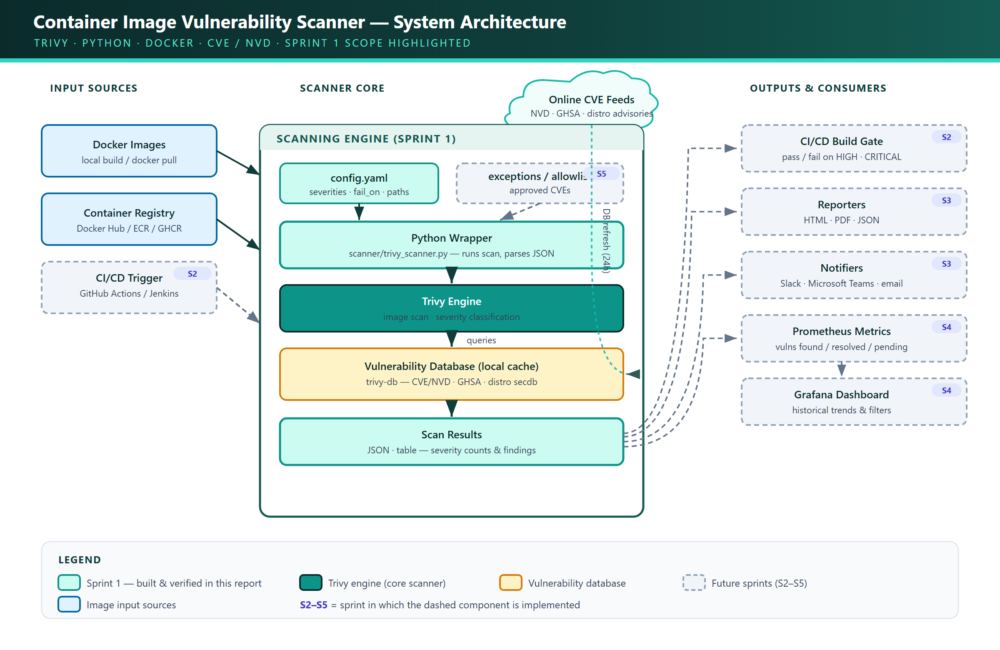
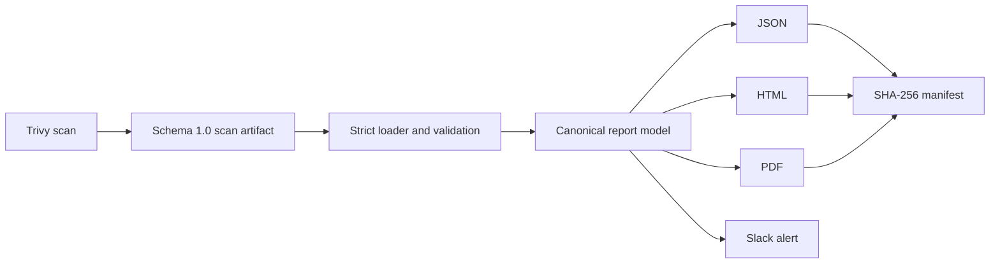

# Container Image Vulnerability Scanner with Reporting

A Trivy-backed Python scanner with CI policy gates, JSON/HTML/PDF evidence, Slack notifications,
expiring vulnerability exceptions, persistent scan history, and local monitoring dashboards.
The delivered Sprint 1-5 implementation is merged into `main`; sprint branches retain milestone
snapshots. Trivy is pinned to **0.74.0**, the wrapper is **0.5.0**, and the integrated suite has
**77 deterministic tests**. Real browser checks cover desktop and mobile layouts.

**Final submission report:** [Complete HTML report](docs/Final_Project_Report.html) |
[Printable PDF](docs/Final_Project_Report.pdf). The report consolidates Sprints 1-5, the final
architecture, genuine screenshots, original scan/test/CI evidence, reproduction steps and
documented limitations and notification verification.

**Vlearn submission package:** [Submission folder](Submission/README.md), including the
repository-link text file, final PDF and standalone HTML report.

## Delivery Status

| Sprint | Delivered capability | Verification |
|---|---|---|
| 1 | Python wrapper, Trivy scan, normalized findings and configuration | Real registry-image scans |
| 2 | Shared severity gate, GitHub Actions and Jenkins pipelines, exit codes 0/1/2/3 | Passing and intentionally blocked builds |
| 3 | JSON/HTML/PDF reports, SHA-256 manifests, Slack, daily/weekly summaries | Real Jenkins HIGH/CRITICAL alerts and daily/weekly deliveries |
| 4 | SQLite history, Flask/Chart.js UI, Prometheus exporter and Grafana | Browser checks, healthy scrape target, 35 tests on the isolated milestone |
| 5 | Scoped expiring exceptions, suppression audit, fresh rescans and bounded retries | Real approval/expiry demonstrations; 77 integrated tests |

**Notification verification:** GitHub and Jenkins use separate `SLACK_WEBHOOK_URL` credentials.
Historical main run #34 and actual scheduled run #2 passed but skipped Slack before the GitHub
secret was configured. After it was added, [HIGH run #37](https://github.com/TabrezAjaz/CapstoneProject/actions/runs/41174455287)
delivered its alert in one attempt, uploaded evidence and restored the expected policy failure.
[Daily summary #3](https://github.com/TabrezAjaz/CapstoneProject/actions/runs/41174502332) succeeded
and delivered in one attempt. Both were manually dispatched; the earlier #2 remains the actual
scheduled-trigger evidence. Original API records and fresh channel receipts are in the final
report. Rotation of the exposed webhook remains a separate security action. The dashboards
are a loopback-only local demonstration, not a public production service.
No Teams/email notifier, automatic registry-digest watcher, or automatic CI-to-laptop importer is
implemented.

## Quick Start

Use Python 3.12+ and install [Trivy 0.74.0](https://trivy.dev/latest/getting-started/installation/)
on your PATH. Docker Desktop/Engine is needed for the monitoring stack, not for registry-reference
CLI scans. Run the following in PowerShell from the repository root:

```powershell
python -m venv .venv
.\.venv\Scripts\Activate.ps1
python -m pip install -r requirements-dev.txt
trivy --version
python -m pytest tests -q

# Clean-image smoke test; Alpine with --fail-on HIGH may intentionally return exit 1.
python -m scanner.trivy_scanner hello-world:latest
$scans = @(Get-ChildItem scan-results -Filter 'hello-world_latest-*.json' | ForEach-Object FullName)
python -m reporters.cli @scans --formats json,html,pdf --output-dir reports
python -m dashboard.cli @scans --metrics-file reports/scan-metrics.prom
python -m dashboard.app --port 5050
```

Open http://127.0.0.1:5050. Reports are written under `reports/`; runtime scan results, history
databases and test output are excluded from Git. For Prometheus/Grafana, follow the
[monitoring runbook](#prometheus-and-grafana) below. Linux/macOS users can activate
`.venv/bin/activate` and pass explicit normalized artifact paths to the same Python modules.

## Deployment Architecture

This is the **implemented Sprint 1-5 deployment architecture**, not a sprint roadmap or execution
flowchart. Boundaries identify where workloads run; stores identify persisted data; labelled arrows
identify file transfers, local database access and network interfaces. GitHub Actions and Jenkins
are alternative CI execution hosts, not sequential services.



[Open full-size diagram](docs/deployment-architecture.svg) |
[PNG for reports and slides](docs/deployment-architecture.png) |
[Editable Mermaid source](docs/deployment-architecture.mmd)

To regenerate the diagram, use Mermaid CLI 11.12.0 with the checked-in rendering configuration
and an installed Chrome executable. This is an optional documentation tool, not a runtime dependency:

```powershell
$env:PUPPETEER_EXECUTABLE_PATH = 'C:\Program Files\Google\Chrome\Application\chrome.exe'
npx --yes --package=@mermaid-js/mermaid-cli@11.12.0 mmdc `
  -i docs/deployment-architecture.mmd -c docs/deployment-architecture.config.json `
  -o docs/deployment-architecture.svg -b white -w 2200
# Repeat with -o docs/deployment-architecture.png -s 2 for the slide export.
```

### Runtime and Storage Boundaries

| Boundary | Runs or stores | Interfaces and persistence |
|---|---|---|
| External services | GitHub source repository, OCI image registry, Trivy DB distribution, Slack | Source checkout, image/DB downloads and HTTPS incoming webhooks |
| CI execution host | Python scanner/report/notifier/metrics CLIs and Trivy subprocess; local DB cache | Configuration and exceptions checked out with source; webhook injected from the provider's secret store |
| CI artifact store | Normalized scans, reports, SHA-256 manifests, metrics snapshot and test evidence | GitHub Actions artifact storage or Jenkins build archives; a blocked gate does not discard evidence |
| Local host | Manual artifact import CLI and `dashboard/data/history.sqlite3` | Idempotent transactional imports; host SQLite file bind-mounted into the dashboard container |
| Docker Compose network | Flask exporter/UI, Prometheus and Grafana | Internal HTTP connections; Prometheus TSDB and Grafana state in named volumes |
| Operator browser | Custom scan explorer and Grafana dashboards | Loopback host ports only; no public ingress configured |

### Key Architectural Decisions

- **Scan-time policy:** Trivy findings are normalized, then scoped unexpired exceptions are applied
  before active severity counts and the gate. Accepted risk remains visible in suppression audit
  fields; it is not counted as remediation.
- **Evidence before final outcome:** CI preserves the scanner result while reporting/notification
  steps run. Evidence is archived even for intentional policy blocks; notification success cannot
  turn a blocked scan into a pass.
- **No direct CI-to-local connection:** download archived normalized scans and import them locally.
  The CI-generated `.prom` file is evidence, not an always-on exporter or a remote history update.
- **Separate histories:** SQLite preserves original scan observations; Prometheus records samples
  only after scraping starts. Grafana queries Prometheus, while the custom UI reads the Flask API.
- **Read-only web surface:** importing is a local CLI operation, not an unauthenticated write API.
  No Node Exporter or Pushgateway is part of this deployment.

### Historical Sprint 1 Component and Workflow Overview

The earlier image is retained as a **Sprint 1 Component and Workflow Overview**, not as the final
deployment architecture. Its dashed boxes describe future work as understood at Sprint 1; its
original embedded title and planned Teams/email labels are historical, not current delivery claims.

<details>
<summary>View the original Sprint 1 overview</summary>



</details>

## Reports and Evidence

- [Final consolidated project report: HTML](docs/Final_Project_Report.html) | [PDF](docs/Final_Project_Report.pdf)
- [Final verification artifacts, command logs, JUnit and GitHub API evidence](docs/evidence/final/)
- [Sprint 1 setup and basic scanning](docs/Sprint1_Setup_and_Basic_Scanning_Report.html)
- [Sprint 2 CI/CD integration](docs/Sprint2_CI_CD_Integration_Report.html)
- [Sprint 3 reporting and notifications](docs/Sprint3_Reporting_and_Notifications_Report.html)
- [Sprint 4 dashboard and monitoring](docs/Sprint4_Dashboard_and_Monitoring_Report.html)
- [Sprint 5 exceptions and reliability](docs/Sprint5_Exceptions_and_Reliability_Report.html)
- [Original Sprint 5 artifacts, generated reports and JUnit results](docs/evidence/sprint5/)
- [Viva preparation: 93 searchable questions and answers](docs/Viva_Preparation_Sprint1_to_5.html)

HTML reports can be opened locally after cloning; GitHub's file viewer shows their source, not a
hosted application. Archived live counts are date/database-specific. Identity correction changed
historical commit hashes without changing file trees; existing CI-run links still describe the
original executions.

## Sprint 2 — CI/CD vulnerability gate

Sprint 2 adds one policy-aware Python CLI shared by GitHub Actions and Jenkins. Every successful
scan writes normalized JSON evidence and evaluates `scanner.fail_on` from `config.yaml`. With the
default `HIGH` policy, HIGH and CRITICAL findings block the build.

### Local usage

```powershell
pip install -r requirements-dev.txt
pytest -q
python -m scanner.trivy_scanner alpine:3.19
python -m scanner.trivy_scanner node:18 --fail-on HIGH
python -m scanner.trivy_scanner --all-configured
```

| Exit | Meaning |
|---:|---|
| 0 | Scan completed and policy passed |
| 1 | Scan completed and policy blocked the image |
| 2 | CLI or configuration is invalid |
| 3 | Trivy, registry, timeout, parsing, or artifact failure |

Configuration precedence is **CLI option > environment variable > YAML > code default**. See
`.env.example` for `SCAN_IMAGE`, `SCANNER_FAIL_ON`, `SCANNER_SEVERITIES`,
`SCANNER_IGNORE_UNFIXED`, `SCANNER_PKG_TYPES`, `SCANNER_TIMEOUT`, and `SCANNER_OUTPUT_DIR`.

### GitHub Actions

`.github/workflows/container-scan.yml` runs on pushes, pull requests, manual dispatches, and
reusable workflow calls. It installs pinned Trivy 0.74.0, refreshes its database, runs tests,
applies the gate, and uploads JSON/JUnit evidence even when policy blocks the build. Repository
variables `SCAN_IMAGE` and `SCANNER_FAIL_ON` can override defaults.
The automatic smoke test uses `hello-world:latest` for a green no-package path; run the workflow
with `alpine:3.19` and `HIGH` to demonstrate an intentional policy block.

### Jenkins

Create a Pipeline job for this repository with **Script Path** `ci/Jenkinsfile`. The pipeline uses
a Linux agent with Python 3, downloads pinned Trivy 0.74.0 without sudo, and installs Python
packages into the workspace without requiring `python3-venv`. Parameters select the image and
policy threshold; JSON and JUnit evidence is retained for both green and blocked builds.

Do not put registry credentials in configuration files or image references. Use masked provider
credentials for private registries. Registry-reference scans do not require the Docker socket.

## Sprint 3 — Reports and notifications

Sprint 3 turns scan output into shareable evidence and real-time alerts. One canonical report
model feeds three renderers, and the same notifier is shared by GitHub Actions and Jenkins.



### Scan artifact schema 1.0

Every scanner run writes a versioned artifact containing `schema_version`, `scan_id`,
`scanned_at` (UTC), `image`, a five-key severity `summary`, normalized `findings`, `policy`,
`scan_options`, `scanner` versions, and sanitized `source` metadata. The report loader rejects raw
Trivy output, legacy files, and any artifact whose summary does not match its findings. See
[docs/SPRINT3_REPORT_SCHEMA.md](docs/SPRINT3_REPORT_SCHEMA.md).

### Generating reports

```powershell
# one image: run report
python -m scanner.trivy_scanner alpine:3.19
python -m reporters.cli scan-results/alpine_3.19-*.json --period run --formats json,html,pdf

# portfolio summary across several artifacts
python -m reporters.cli scan-results/*-????????.json --period daily --formats json,html,pdf `
  --output-dir reports --title "Daily Container Vulnerability Summary"
```

Reports exit `0` on success, `2` for invalid input or configuration, and `3` for rendering or I/O
failure. A `<name>.manifest.json` file is written last and records each output's media type, size,
and SHA-256 checksum.

### Slack alerts

```powershell
$env:SLACK_WEBHOOK_URL = "<incoming webhook>"   # never store this in a file
python -m notifiers.cli reports/vulnerability-daily-*.json --always
```

- Delivery uses `SLACK_WEBHOOK_URL` from the environment or a CI credential binding only.
- The URL must be an HTTPS `hooks.slack.com` (or `hooks.slack-gov.com`) `/services/...` webhook.
  Credentials in the URL, fragments, redirects, and non-443 ports are refused.
- `notifications.alert_on` in `config.yaml` (default `HIGH`) controls immediate run alerts.
  CRITICAL is urgent/red, HIGH is action-required/orange, MEDIUM warning/yellow, and LOW
  informational/blue. Daily and weekly summaries are always sent.
- Failures are retried at most three times with bounded backoff for timeouts, `408`, `425`, `429`,
  and `5xx`. Other `4xx` responses are not retried. Notifier exit `3` means delivery was exhausted.
- Scan-controlled values are truncated and `@channel`/`@here` mentions are stripped.

### Scheduling

`.github/workflows/scheduled-summaries.yml` performs a fresh scan of every image in `config.yaml`
at 02:23 UTC daily and 03:41 UTC on Mondays, and can be dispatched manually with `daily` or
`weekly`. Scheduled runs use the repository's default branch. Manual dispatch requires the workflow
to exist on that branch, and can select another branch. These workflows are merged into `main`;
manual workflow runs are verification,
not evidence that a cron event fired at its scheduled time.

For Jenkins, create two Pipeline jobs that both point to **Script Path** `ci/Jenkinsfile.summaries`
with UTC cron triggers `H 2 * * *` and `H 3 * * 1`. `NOTIFY` defaults to true.
`SUMMARY_PERIOD=auto` chooses weekly for a job name ending in `-Weekly`, otherwise daily;
explicit `daily` and `weekly` overrides remain available. Daily #17 and weekly #5 verified the
saved defaults, correct cadence, successful Slack delivery, and archived evidence.
Sprint 3 reached `main` on 29 October 2026. GitHub Slack needs its own `SLACK_WEBHOOK_URL` secret;
the Jenkins credential does not configure GitHub.

### Failure precedence

When normalized scan artifacts exist, reporting runs before final gate enforcement; Slack runs
when its secret and notification conditions are satisfied. Artifact upload/archiving is attempted
even when earlier stages fail. The scanner exit code still decides the gate: a blocked image keeps
the build red even when reporting and Slack delivery succeed. Report and exhausted-delivery
failures are operational failures. Scheduled summary jobs treat a policy block as a valid summary
result and fail only on operational errors. A scanner failure without valid artifacts cannot
produce a vulnerability report.

### Operating Scope

No paid cloud infrastructure is provisioned by this repository. Local compute/storage, registry
downloads, GitHub Actions allowances, Slack workspace capabilities and the academic Jenkins
controller remain subject to their own availability and plan limits. Image and database downloads
can recur; they are not one-time network costs.

## Sprint 4 - Dashboard and Monitoring

### Persistent history and local dashboard

Run all commands from the repository root. Import normalized scanner artifacts, not report JSON
or raw Trivy output. Repeated imports of the same scan ID are idempotent; conflicting reuse of a
scan ID fails the whole import transaction. New observations of an image remain separate scans.

```powershell
pip install -r requirements-dev.txt
$artifacts = @(Get-ChildItem scan-results -Filter '*-????????.json' | ForEach-Object FullName)
python -m dashboard.cli @artifacts --metrics-file reports/scan-metrics.prom
python -m dashboard.app --port 5050
```

Open http://127.0.0.1:5050. The UI provides image/severity/date filters, historical observations,
per-image policy state, scan drilldowns, approved-exception details, and JSON downloads.
The API is read-only: `/api/overview`, `/api/scans/<scan_id>`, `/healthz`, and `/metrics`.
SQLite history defaults to `dashboard/data/history.sqlite3`, which is excluded from Git and Docker
build contexts. Use `--database` on both importer and server to select another database.

For an existing CI build, download its normalized scan artifacts and import them locally.
CI archives `reports/scan-metrics.prom`; its temporary database is not a central history store.
The local history importer is intentionally a CLI, not an unauthenticated remote write endpoint.

### Prometheus and Grafana

```powershell
# Set a private, non-default password directly in your terminal; never commit it.
$env:GRAFANA_ADMIN_PASSWORD = '<your-private-password>'
docker compose -f dashboard/compose.yaml up -d --build
```

- Containerized dashboard: http://127.0.0.1:5051
- Prometheus target health: http://127.0.0.1:9095/targets
- Grafana: http://127.0.0.1:3030/d/container-security

Prometheus scrapes the persistent exporter every 15 seconds and retains 15 days of scrape history.
Grafana provisions its Prometheus datasource and eight panels automatically, with image/severity
variables and a UTC time picker. It permits anonymous **Viewer** access only; published ports
bind to loopback. Administrative login uses your environment password. Both monitoring services
use named volumes; do not use `down -v` unless you intend to delete their history.
This is a local demonstration deployment, not an authenticated public production service.

### Metric Semantics

| Metric | Meaning |
|---|---|
| `vulnerability_findings{image,severity}` | Active latest-scan finding counts |
| `vulnerability_blocking_findings{image}` | Active findings at/above the policy threshold |
| `vulnerability_policy_blocked{image}` | 1 blocked, 0 passed |
| `vulnerability_new_findings{image}` | New advisory/package pairs compared with the previous scan |
| `vulnerability_resolved_findings{image}` | Previous advisory/package pairs now absent |
| `vulnerability_suppressed_findings{image}` | Approved exceptions, separately visible |
| `vulnerability_scan_timestamp_seconds{image}` | Latest actual scan time, for staleness alerts |
| `vulnerability_scans_stored` | Persisted artifact count, a gauge rather than a process counter |

New/resolved values are gauges for the latest scan transition, not cumulative event counters.
The first observation is a baseline: all observed pairs are new and none are resolved.
Suppressing a vulnerability is not remediation: comparisons include active plus suppressed pairs.
An absent vulnerability is an observation within the configured Trivy scope, not proof that a
patch was installed. Date filters choose observations in that range and use the prior stored
observation as a comparison baseline. Pending is the latest active finding count per image.
Policy-blocking totals always use the full configured gate, even under a severity display filter.

SQLite preserves original scan timestamps. Prometheus starts history when it begins scraping;
it does not backfill old SQLite scans. No historical data or remediation is fabricated.

### Verification

```powershell
python -m pytest -q
# Install Chromium once, or pass --executable with an installed Chrome path.
python -m playwright install chromium
python -m dashboard.browser_check
```

The browser check validates API/UI totals, filters, empty/error states, scan details, readable
controls, no page overflow, and nonblank chart pixels at 1440x1080 and 390x844. It saves genuine
screenshots and a JSON verification record under `docs/screenshots`.
An optional `--audit-scan-id` captures an existing approved-exception audit view.

## Sprint 5 - Exceptions, Rescans and Reliability

The scanner applies `exceptions_file` before calculating active severity counts and the policy
gate. The committed production allowlist is deliberately empty. Each approval requires an exact
advisory `id`, a non-empty `reason`, and an expiry in `YYYY-MM-DD` format; optional `image` and
`pkg` values restrict it to exact scopes. Wildcards, duplicate scopes, malformed fields and missing
configured files fail closed with exit `2` before Trivy starts.

```yaml
exceptions:
  - id: CVE-2026-40200
    image: alpine:3.19
    pkg: musl
    reason: "Example only: temporary reviewed risk acceptance"
    expires: 2026-10-30
```

Expiry is inclusive through that UTC calendar date. Expired entries remain visible in audit
metadata but do not suppress findings. Matching uses the first non-expired rule with the exact ID
and matching optional scopes. Configuration precedence remains CLI > environment > YAML > defaults.
A YAML `exceptions_file` path is relative to that YAML file; CLI/environment paths are relative to
the working directory. The reference `.env.example` is not automatically loaded by the application.

Schema `1.0` gains additive `raw_summary`, `suppressed_findings`, `exception_policy`, and optional
`rescan_of` fields. Active findings determine the gate; suppressed findings retain package/version,
reason and expiry. The exception file SHA-256 and evaluation date are recorded. JSON, HTML, PDF
and the dashboard expose approved exceptions separately. The report loader rejects inconsistent
active counts, forged policy states, and broken suppression-count audits.
Trivy's implicit `.trivyignore` file is disabled so it cannot bypass the audited approval policy.

### Fresh Rescans

```powershell
python -m scanner.trivy_scanner alpine:3.19 --refresh-db --output-dir scan-results/baseline
python -m scanner.trivy_scanner --rescan-artifact scan-results/baseline/alpine_3.19-6bd2275d.json `
  --output-dir scan-results/rescan
```

Every rescan actually invokes Trivy, creates a new UUID/UTC timestamp, and records the previous
scan ID as `rescan_of`. It does not replay old findings. Use separate output directories and import
both observations to preserve history. Daily/weekly jobs already refresh the database and rescan
all configured images; no automatic image-digest watcher is claimed.

### Bounded Retries and Failures

Default: two retries after the first attempt, with 1s then 2s backoff, capped at 30s. Configure
`--retries` / `SCANNER_RETRIES` (0..5) and `--retry-backoff` / `SCANNER_RETRY_BACKOFF` (0..30s).
Only recognized transient network/registry failures and process timeouts are retried. Missing
executables, invalid JSON, authentication/authorization failures, missing manifests and permanent
errors fail immediately. A process deadline bounds each attempt to the configured Trivy timeout
plus 30 seconds; enclosing CI timeouts remain an additional bound. `--refresh-db` uses the same
classified retry helper. Vulnerability policy failures are never retried as operational errors.

Exit codes remain 0 pass, 1 policy block, 2 configuration, 3 operational failure. Malformed Trivy
result shapes cannot become clean scans. Artifacts are written with atomic replacement; a failed
write does not produce a partial successful-looking JSON file.

### Evidence and Demonstrations

`tests/fixtures/allowlist-alpine-demo.yaml` is explicitly non-production and date-specific.
On 29 October 2026, its temporary rule produced 8 active / 2 suppressed findings and exit 0.
The expired fixture restored 10 active / 0 suppressed findings and exit 1. A missing policy
returned exit 2 without scanning. The normal allowlist remains empty.

The full integrated suite has 77 deterministic passing tests, and exact desktop/mobile browser
checks passed. Small public Alpine demonstration artifacts, generated reports and JUnit evidence
are intentionally archived under `docs/evidence/sprint5`; production inventories, credentials,
runtime history databases and secrets are not committed. Real scan counts are date/database
specific; deterministic tests use fixtures. Transient retries were verified by controlled unit
tests, not by claiming an unperformed live network fault injection.

