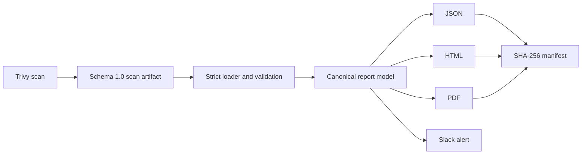

# CapstoneProject
Project Title: Container Image Vulnerability Scanner with Reporting

## Architecture Overview

The diagram below shows the complete system we designed for this project. We planned the
full architecture up front and are building it incrementally across six sprints. In the diagram,
the components highlighted in teal are the ones we have already built and verified in **Sprint 1**
(the scanning engine), while the dashed boxes are the parts our team will add in the later sprints
(tagged `S2`–`S5`).


We laid the system out as a left-to-right pipeline so it is easy to follow how an image travels
from input, through scanning, to the final outputs. It is organised into three parts.

### 1. Input Sources (left)

This is where a container image comes from before we scan it:

- **Docker Images** — images we build locally or pull with `docker pull`.
- **Container Registry** — images stored in Docker Hub, Amazon ECR, or GHCR.
- **CI/CD Trigger** *(Sprint 2)* — later, a pipeline (GitHub Actions / Jenkins) will hand an image
  to the scanner automatically on every code push.

### 2. Scanner Core (center) — what we built in Sprint 1

This is the heart of the project and the work we completed in Sprint 1. The flow inside it is:

1. **`config.yaml`** — our central configuration. We keep all settings here (which severities to
   report, the `fail_on` threshold, output paths) so nothing is hard-coded.
2. **Python Wrapper** (`scanner/trivy_scanner.py`) — the wrapper we wrote that reads the config,
   runs the scan, and parses the results into a clean format.
3. **Trivy Engine** — the scanner that actually inspects the image and classifies findings by
   severity.
4. **Vulnerability Database (local cache)** — Trivy's local copy of known vulnerabilities
   (**CVE/NVD**, GitHub advisories, and distro security data). It refreshes from the online
   **CVE feeds** roughly every 24 hours, which is what keeps our checks up to date.
5. **Scan Results** — the structured output we produce (JSON + table) with per-severity counts and
   the list of findings.

### 3. Outputs & Consumers (right) — planned for later sprints

These are the parts we will connect the scan results to in the upcoming sprints:

- **CI/CD Build Gate** *(Sprint 2)* — pass or fail a build when HIGH/CRITICAL issues are found.
- **Reporters** *(Sprint 3)* — generate HTML, PDF, and JSON reports.
- **Notifiers** *(Sprint 3)* — send alerts to Slack, Microsoft Teams, or email.
- **Prometheus + Grafana** *(Sprint 4)* — collect metrics and show historical trends on a dashboard.
- **Exceptions / Allowlist** *(Sprint 5)* — let us approve known CVEs so they are filtered out of
  the reports.

### Why we designed it this way

- **Separation of concerns** — we kept the Python wrapper as a thin layer over Trivy, so the core
  does one job well and we can add reporting, notifications, and CI/CD later without rewriting it.
- **Config-driven** — because thresholds and paths live in `config.yaml`, we can change the
  scanner's behaviour without touching the code. The `fail_on` value is what we will use to break a
  CI build in Sprint 2.
- **Runs locally and for free** — everything runs on Docker Desktop and Python, so our running cost
  stays at zero (the only network use is the one-time database and image downloads).
- **Standards-based** — every finding maps back to an official **CVE/NVD** identifier with a CVSS
  score, so our severities follow the industry standard rather than anything we invented.

## Sprint 2 — CI/CD vulnerability gate

Sprint 2 adds one policy-aware Python CLI shared by GitHub Actions and Jenkins. Every successful
scan writes normalized JSON evidence and evaluates `scanner.fail_on` from `config.yaml`. With the
default `HIGH` policy, HIGH and CRITICAL findings block the build.

### Local usage

```powershell
pip install -r requirements-dev.txt
pytest -q
python -m scanner.trivy_scanner alpine:3.19
python -m scanner.trivy_scanner node:18 --fail-on HIGH
python -m scanner.trivy_scanner --all-configured
```

| Exit | Meaning |
|---:|---|
| 0 | Scan completed and policy passed |
| 1 | Scan completed and policy blocked the image |
| 2 | CLI or configuration is invalid |
| 3 | Trivy, registry, timeout, parsing, or artifact failure |

Configuration precedence is **CLI option > environment variable > YAML > code default**. See
`.env.example` for `SCAN_IMAGE`, `SCANNER_FAIL_ON`, `SCANNER_SEVERITIES`,
`SCANNER_IGNORE_UNFIXED`, `SCANNER_PKG_TYPES`, `SCANNER_TIMEOUT`, and `SCANNER_OUTPUT_DIR`.

### GitHub Actions

`.github/workflows/container-scan.yml` runs on pushes, pull requests, manual dispatches, and
reusable workflow calls. It installs pinned Trivy 0.74.0, refreshes its database, runs tests,
applies the gate, and uploads JSON/JUnit evidence even when policy blocks the build. Repository
variables `SCAN_IMAGE` and `SCANNER_FAIL_ON` can override defaults.
The automatic smoke test uses `hello-world:latest` for a green no-package path; run the workflow
with `alpine:3.19` and `HIGH` to demonstrate an intentional policy block.

### Jenkins

Create a Pipeline job for this repository with **Script Path** `ci/Jenkinsfile`. The pipeline uses
a Linux agent with Python 3, downloads pinned Trivy 0.74.0 without sudo, and installs Python
packages into the workspace without requiring `python3-venv`. Parameters select the image and
policy threshold; JSON and JUnit evidence is retained for both green and blocked builds.

Do not put registry credentials in configuration files or image references. Use masked provider
credentials for private registries. Registry-reference scans do not require the Docker socket.

## Sprint 3 — Reports and notifications

Sprint 3 turns scan output into shareable evidence and real-time alerts. One canonical report
model feeds three renderers, and the same notifier is shared by GitHub Actions and Jenkins.



### Scan artifact schema 1.0

Every scanner run writes a versioned artifact containing `schema_version`, `scan_id`,
`scanned_at` (UTC), `image`, a five-key severity `summary`, normalized `findings`, `policy`,
`scan_options`, `scanner` versions, and sanitized `source` metadata. The report loader rejects raw
Trivy output, legacy files, and any artifact whose summary does not match its findings. See
[docs/SPRINT3_REPORT_SCHEMA.md](docs/SPRINT3_REPORT_SCHEMA.md).

### Generating reports

```powershell
# one image: run report
python -m scanner.trivy_scanner alpine:3.19
python -m reporters.cli scan-results/alpine_3.19-*.json --period run --formats json,html,pdf

# portfolio summary across several artifacts
python -m reporters.cli scan-results/*-????????.json --period daily --formats json,html,pdf `
  --output-dir reports --title "Daily Container Vulnerability Summary"
```

Reports exit `0` on success, `2` for invalid input or configuration, and `3` for rendering or I/O
failure. A `<name>.manifest.json` file is written last and records each output's media type, size,
and SHA-256 checksum.

### Slack alerts

```powershell
$env:SLACK_WEBHOOK_URL = "<incoming webhook>"   # never store this in a file
python -m notifiers.cli reports/vulnerability-daily-*.json --always
```

- Delivery uses `SLACK_WEBHOOK_URL` from the environment or a CI credential binding only.
- The URL must be an HTTPS `hooks.slack.com` (or `hooks.slack-gov.com`) `/services/...` webhook.
  Credentials in the URL, fragments, redirects, and non-443 ports are refused.
- `notifications.alert_on` in `config.yaml` (default `HIGH`) controls immediate run alerts.
  CRITICAL is urgent/red, HIGH is action-required/orange, MEDIUM warning/yellow, and LOW
  informational/blue. Daily and weekly summaries are always sent.
- Failures are retried at most three times with bounded backoff for timeouts, `408`, `425`, `429`,
  and `5xx`. Other `4xx` responses are not retried. Notifier exit `3` means delivery was exhausted.
- Scan-controlled values are truncated and `@channel`/`@here` mentions are stripped.

### Scheduling

`.github/workflows/scheduled-summaries.yml` performs a fresh scan of every image in `config.yaml`
at 02:23 UTC daily and 03:41 UTC on Mondays, and can be dispatched manually with `daily` or
`weekly`. GitHub only evaluates `schedule` and `workflow_dispatch` from the repository's default
branch, so merge the workflow to `main` to activate the timers.

For Jenkins, create two Pipeline jobs that both point to **Script Path** `ci/Jenkinsfile.summaries`
and pass `SUMMARY_PERIOD` as `daily` and `weekly`, with UTC cron triggers `H 2 * * *` and
`H 3 * * 1`. Each run rescans all configured images, so summaries always reflect current
vulnerabilities; no history database or dashboard is involved (that is Sprint 4).

### Failure precedence

Scanning, reporting, and notification all run so evidence is never lost. The scanner exit code
still decides the gate: a blocked image keeps the build red even when reporting and Slack delivery
succeed. Report and exhausted-delivery failures are operational failures. Scheduled summary jobs
treat a policy block as a valid summary result and fail only on operational errors.

### Cost

Reports and notifications add no paid services: Jinja2 and ReportLab run locally, Slack's incoming
webhooks are free on the current plan, and Trivy, GitHub-hosted runners, and the academic Jenkins
controller are already in use.

